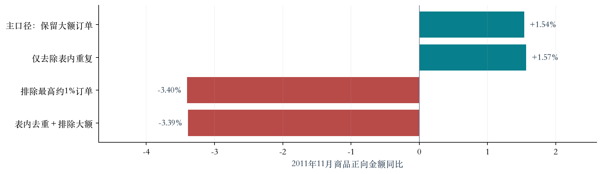
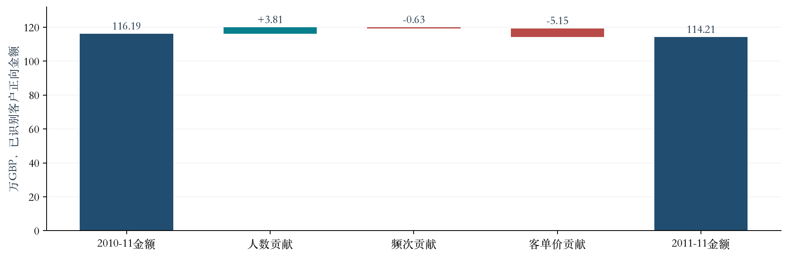
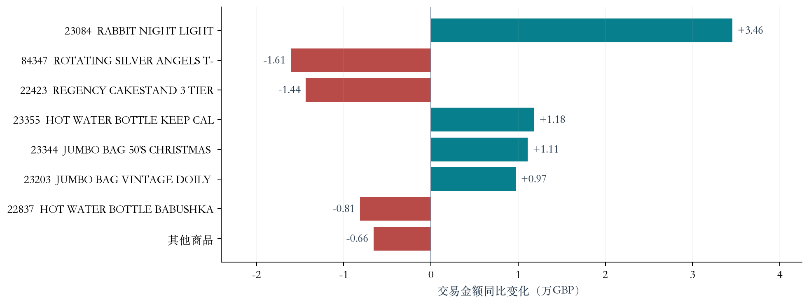
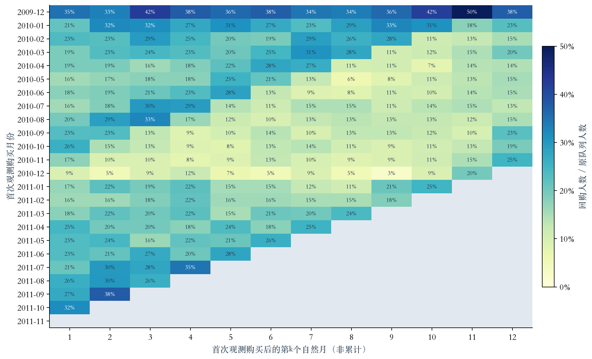

# 电商销售波动与用户复购分析报告

处理日期：2026-11-11。公开历史数据个人项目；分析第1-10节已完成；Tableau经营看板已制作并展示，在线发布尚未确认，第11节不整体标记完成。

专题：以2011年11月对2010年11月同比为重点，结合客户复购队列。

## 目录

以下页码为配套PDF实际页码，包含封面与目录。

| 章节 | PDF页码 |
| --- | ---: |
| 1. 执行摘要：问题、结论与行动 | 3 |
| 2. 销售变化分析 | 4–5 |
| 3. 商品与客群贡献 | 6 |
| 4. 客户复购分析 | 7 |
| 5. 业务行动方案 | 8 |

## 1. 执行摘要：问题、结论与行动

**现状与目标：**2011年11月商品正向交易金额同比增长1.54%。判断增长是否稳健，定位销售变化的主要因素，并识别持续购买的运营机会，为资源投入和试点选择提供依据。

| 业务问题 | 核心结论 | 建议行动 |
| --- | --- | --- |
| 销售为什么变化，增长是否稳健？ | 排除大额订单后同比-3.40%；已识别客户客单价下降4.38%，负向贡献超过人数增长的正向贡献 | P1：互补推荐与组合购买；大额和普通订单分开评价 |
| 哪些商品和客群值得关注？ | 商品涨跌并存；首次观测月客户贡献下降、历史客户贡献增加 | P2：选择候选商品调整推荐；需求、库存与毛利支持后才调整备货 |
| 客户是否持续购买？ | 次月复购率20.49%→23.60%，增加3.11个百分点，非运营效果的因果证据 | P3：首购后使用建议、相关推荐及回购提醒，以对照组验证 |

**建议决策：**优先验证订单价值方案，其余按条件成熟度推进。试点前确认预算、样本量和停止条件，以增量毛利及转化、退货或退订约束共同判断效果。业务方案尚未实施。

**阅读路径：**第4—5页判断增长与拆解因素；第6页定位商品和客群；第7页比较复购；第8页给出业务行动。金额为GBP商品正向交易金额，未扣除退货，不是净收入或利润。

## 2. 销售变化分析

### 2.1 问题1：销售为什么变化，增长是否稳健？

**结论：**全量商品正向金额同比增长1.54%，但使用同一门槛排除大额订单后下降3.40%，不能认定普遍改善。

**证据1：增长对大额订单敏感，去重影响较小。**

仅去除表内重复，同比为+1.57%。大额门槛为完整分析期订单金额99分位数4,008.5903 GBP，两期用同一门槛整单排除；主分析仍保留真实大额交易。

**业务解释：**大额交易可能来自真实批发需求，应保留其经营价值；总额同时可能掩盖其他订单的表现，因此应分开跟踪金额、订单数和持续购买，不能仅凭+1.54%认定全面改善。

**行动启示：**维护可识别的大额客户，提供补货提醒与订单服务；普通订单另行评价。这不是已经证明客户流失或服务不足。

**下一页的分析范围：**已识别客户金额下降1.70%（减少19,708.64 GBP），未知客户金额增加41,774.05 GBP，合计增加22,065.41 GBP。只有已识别客户能做人数、频次及客单价拆解。已识别金额覆盖率80.93%→78.35%，影响代表性；未知ID不代表无效订单，也不等于大额订单。

### 2.2 已识别客户金额为何下降？

**结论：**客单价下降的负向贡献超过人数增长的正向贡献，已识别客户金额减少19,708.64 GBP（-1.70%）。

**拆解逻辑：交易金额 = 购买人数 × 人均订单数 × 客单价。**仅对客户ID非空交易计算。

| 指标 | 2010年11月 | 2011年11月 | 变化 |
| --- | ---: | ---: | --- |
| 购买人数 | 1,606 | 1,660 | +3.36% |
| 人均订单数 | 1.6002 | 1.5916 | 小幅下降 |
| 客单价（GBP/订单） | 452.08 | 432.30 | -4.38% |

人数、频次、客单价分别贡献+38,108.57、-6,269.09、-51,548.12 GBP，合计-19,708.64 GBP。两端蓝柱为两期金额，中间为因素贡献。Shapley平均全部6种替换顺序，只解释数值变化，不识别业务原因。

**业务解释：**购买人数增加未抵消每单金额下降，应同时关注订单价值；尚不能确定原因是价格、件数还是商品组合。

**行动启示：**优先测试互补推荐与组合购买，目标是提高每单件数，同时评价转化及每位分配用户的毛利，避免客单价提高却损害总收益。**下一问：哪些商品和客群推动或拖累销售？**下面恢复全量交易口径，从另一个角度定位变化。

## 3. 哪些商品和客群推动或拖累销售？

**结论：**增长来源分化，资源应有选择地投入；商品和客户分别配置运营动作。

### 商品：定位推荐与调整候选

23084（RABBIT NIGHT LIGHT，兔子夜灯）贡献+34,556.72 GBP；84347、22423分别贡献-16,077.40、-14,351.75 GBP。增长商品进入推荐与备货评估候选，下降商品可小范围测试搭配推荐；须结合近期需求、库存与毛利确认投入。

### 客群：区分首购表现与老客经营

| 客户类别 | 同比金额贡献（GBP） | 含义 |
| --- | ---: | --- |
| 首次观测购买月客户 | -72,586.54 | 该类别交易金额下降 |
| 已有更早购买记录的客户 | +52,877.90 | 该类别交易金额增加 |
| 客户ID未知 | +41,774.05 | 无法归入前两类 |

首次观测月客户贡献下降不等于获客失败；历史客户金额增加不等于复购率提高。分类受历史累积影响。

**业务含义：**商品分层配置推荐与补货资源，客户分别安排首购后跟进与老客维护。**下一问：客户是否持续回来购买？**

贡献为本期金额减基期金额。商品图取绝对贡献前7项，加“其他”闭合；商品和客群各自解释全量增加22,065.41 GBP，不能跨维度相加。首次观测不等于真实首购，基期无交易不等于新品上市。

## 4. 客户后续购买表现如何？

**结论：**同期队列次月复购率20.49%→23.60%，增加3.11个百分点；是描述性差异，不能归因于运营策略。

### 比较规则与主要证据

同一首次观测购买月的客户组成队列，统计下一自然月再次购买的人数。只比较完整观察的次月，合并比例按队列人数加权。

| 队列范围 | 客户人数 | 次月回购人数 | 次月复购率 |
| --- | ---: | ---: | ---: |
| 2010年1—10月 | 2,962 | 607 | 20.49% |
| 2011年1—10月 | 1,318 | 311 | 23.60% |

### 辅助证据：后续各月的回购情况

读图：每行是首次观测购买月，每列是此后第k个自然月，格子为原队列在该月回购的比例。横向看同组客户后续表现，纵向比较相同月龄；灰色是未完整观察，不是零。

**业务解释：**数据未证明复购恶化，也不证明既有运营有效。

**行动启示：**首购后使用建议、相关推荐和回购提醒属于持续购买促进试点，而不是恶化补救；以随机对照验证30天回购及增量毛利。下一节汇总业务行动。

首次观测不等于真实首购；2009年12月尤其混入历史老客，后续队列受历史累积与客群结构影响。自然月次月复购不等于固定30天回购，不将月龄0视为复购。

## 5. 业务行动方案（建议试点，尚未实施）

优先级依据问题直接性和实施条件，不代表预计收益排名。

| 优先级／目标 | 对象与具体动作 | 协作和试点 | 评价与决策 |
| --- | --- | --- | --- |
| P1 提高普通订单价值 | 普通订单客户；详情页或购物车增加互补推荐、组合购买入口，首轮不默认降价 | 商品运营、产品／技术、数据分析；少量库存和毛利条件具备商品，客户或会话随机分组 | 件数、客单价、每位分配用户毛利增量；转化及退货约束达标后再扩大 |
| P2 配置商品资源 | 贡献增长和下降商品作为候选，测试推荐位置和搭配；需求、库存与毛利支持后调整补货 | 商品运营、供应链、数据分析；推荐随机对照，补货分批实施 | 品类整体销售毛利、缺货和库存周转；排查销售转移与积压，简单前后变化不视为因果效果 |
| P3 促进首购后购买 | 可识别且允许触达客户；使用建议、相关推荐和回购提醒；高频客户提供补货提醒 | 客户运营、数据分析；按实施前信息确定名单，随机保留对照组 | 30天回购、每位分配客户毛利增量；监测退订、退货和触达成本 |

**启动前确认：**预算、样本量、效果门槛和停止条件预先确定，按约定决定扩大、调整或停止。现有数据不支持可信的收益预测或统一门槛。大额订单单独跟踪，并为可识别客户提供订单服务。

**老客维护依据：**全期累计购买10次及以上的941位客户贡献已识别金额约66.9%，仅为事后集中度描述，不能用全期名单模拟历史触达。自然月次月复购与试验固定30天回购不直接替代。缺少成本、库存和支付退款等资料，须补齐相应实施条件。

来源：Chen, D. (2012). Online Retail II [Dataset]. UCI Machine Learning Repository. https://doi.org/10.24432/C5CG6D. 许可CC BY 4.0。
